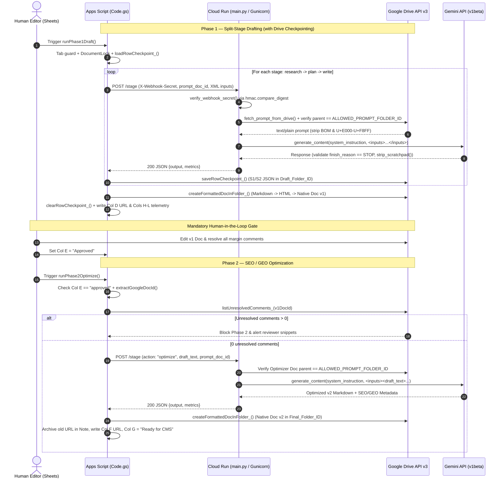

# Developer & Operations Guide (`hitl-content-engine`)

This guide covers the internal architecture, security boundaries, local development workflow, testing, CI/CD pipeline, and cloud deployment conventions for engineers maintaining or self-hosting `hitl-content-engine`.

---

## 1. Architecture & Internal Data Flow

`hitl-content-engine` is a stateless, two-phase Human-in-the-Loop (HITL) content generation pipeline:

1. **Orchestration Layer (`apps_script/Code.gs`):** Runs inside Google Sheets as a bound Apps Script (V8 runtime) with the **Drive v3 Advanced Service**. It enforces tab guards, acquires `LockService.getDocumentLock()`, reads experiment routing from the `Experiment_Config` tab, and sends authenticated `POST /stage` requests to Cloud Run.
2. **Compute & Security Boundary (`backend/main.py`):** A Flask + Gunicorn HTTP service on Cloud Run running under a dedicated least-privilege Service Account. It validates `X-Webhook-Secret` via `hmac.compare_digest`, fetches and sanitizes the requested prompt Google Doc server-side from `ALLOWED_PROMPT_FOLDER_ID`, wraps XML-escaped inputs in `<inputs>...</inputs>`, and calls the Gemini API (`v1beta`).
3. **Storage & Human Gate (Google Drive & Docs):** Apps Script persists intermediate Phase 1 outputs in Drive checkpoints, imports finished Markdown as formatted native Google Docs via `Drive.Files.create`, and gates Phase 2 on both normalized `"approved"` status and `0` unresolved Google Docs comments (`Drive.Comments.list`).



---

## 2. Repository Structure

```text
.
├── .env.example                 # Local backend environment variable template (no real secrets)
├── .gitignore                   # Excludes .venv, .env*, caches, and OS artifacts
├── cloudbuild.yaml              # Cloud Build CI/CD pipeline: pytest gate -> Docker build -> push -> deploy
├── DEVELOPERS.md                # Technical architecture, setup, testing, and operations guide (this file)
├── README.md                    # High-level overview and end-to-end replication guide
├── apps_script/
│   ├── Code.gs                  # Google Sheets menu, split-stage orchestrator, checkpointing, MD->HTML importer
│   └── appsscript.json          # Apps Script V8 manifest enabling Drive v3 Advanced Service & OAuth scopes
├── backend/
│   ├── .dockerignore            # Excludes tests/, .venv/, .env*, and caches from Docker build context
│   ├── Dockerfile               # Hardened python:3.11.11-slim-bookworm image, non-root appuser, Gunicorn CMD
│   ├── main.py                  # Flask/functions-framework webhook: auth, Drive prompt fetch, Gemini stages
│   ├── requirements.txt         # Pinned Python runtime and pytest dependencies
│   └── tests/
│       └── test_main.py         # Unit test suite (30 tests covering auth, Drive allowlist, XML, retries, stages)
└── prompts/
    ├── agent_a_researcher.md    # Sanitized Agent A (Research Analyst) system prompt template
    ├── agent_b_planner.md       # Sanitized Agent B (Editorial Architect) system prompt template
    ├── agent_c_writer.md        # Sanitized Agent C (B2B SaaS Content Writer) system prompt template
    └── agent_d_optimizer.md     # Sanitized Agent D (SEO/GEO Optimizer) system prompt template
```

---

## 3. Prerequisites & Third-Party Setup (From Scratch)

Follow these steps to self-host the stack in your own GitHub, Google Cloud, and Google Workspace accounts.

### 3.1. GitHub Fork & Clone

1. Fork this repository into your GitHub account/organization and clone it locally:
   ```bash
   git clone https://github.com/<YOUR_GITHUB_ORG>/hitl-content-engine.git
   cd hitl-content-engine
   ```
2. Work on feature branches (`git checkout -b feat/<name>`) rather than committing directly to `main`.
3. In GitHub **Settings -> Branches**, add a branch protection rule on `main` requiring pull requests and passing status checks before merging, because pushes to `main` trigger Cloud Build auto-deployments.

### 3.2. Google Cloud Project Setup

Set your project variables and enable the five required APIs:

```bash
export PROJECT_ID="<YOUR_GCP_PROJECT_ID>"
export REGION="europe-west1"
export SERVICE_NAME="hitl-content-webhook"
export RUNTIME_SA_NAME="content-engine-runtime"
export RUNTIME_SA_EMAIL="${RUNTIME_SA_NAME}@${PROJECT_ID}.iam.gserviceaccount.com"

gcloud services enable \
  run.googleapis.com \
  cloudbuild.googleapis.com \
  artifactregistry.googleapis.com \
  secretmanager.googleapis.com \
  drive.googleapis.com \
  --project="${PROJECT_ID}"
```

### 3.3. IAM & Least-Privilege Service Account

> **Why a Dedicated Runtime SA Is Mandatory:** Never run Cloud Run as the default Compute Engine Service Account (`<PROJECT_NUMBER>-compute@developer.gserviceaccount.com`). That default identity is shared with Cloud Build and typically holds `roles/run.admin`, `roles/iam.serviceAccountUser`, and `roles/artifactregistry.writer`. Any container compromise would yield project-wide deployment and image-overwrite privileges.

Create `content-engine-runtime` with only log-writing permissions, and allow Cloud Build to attach it during deploys:

```bash
# 1. Create dedicated least-privilege runtime Service Account
gcloud iam service-accounts create "${RUNTIME_SA_NAME}" \
  --display-name="HITL Content Engine Cloud Run Runtime" \
  --project="${PROJECT_ID}"

# 2. Grant only Cloud Logging write access at the project level
gcloud projects add-iam-policy-binding "${PROJECT_ID}" \
  --member="serviceAccount:${RUNTIME_SA_EMAIL}" \
  --role="roles/logging.logWriter"

# 3. Allow your Cloud Build Service Account to deploy Cloud Run revisions using this runtime SA
PROJECT_NUMBER="$(gcloud projects describe "${PROJECT_ID}" --format='value(projectNumber)')"
gcloud iam service-accounts add-iam-policy-binding "${RUNTIME_SA_EMAIL}" \
  --member="serviceAccount:${PROJECT_NUMBER}-compute@developer.gserviceaccount.com" \
  --role="roles/iam.serviceAccountUser" \
  --project="${PROJECT_ID}"
```

### 3.4. Gemini API Key & Secret Manager

1. **Obtain a Gemini API Key:**
   - Generate a standard Gemini Developer API key (`AIzaSy...` prefix) in [Google AI Studio](https://aistudio.google.com/apikey).
   - *Note on `AQ.A...` keys:* Keys with an `AQ.A...` prefix are Vertex AI Express Mode keys targeting `aiplatform.googleapis.com/v1beta1` (`vertexai=True`), whereas `backend/main.py` initializes `genai.Client(api_key=..., http_options=types.HttpOptions(api_version="v1beta"))` for the Gemini Developer API (`generativelanguage.googleapis.com/v1beta`). Use a standard `AIzaSy...` key unless you explicitly adapt `_build_genai_client()` for Vertex AI Express Mode.
2. **Store Both Secrets Safely (No Shell History Leakage):**
   ```bash
   # Create Secret Manager containers
   gcloud secrets create gemini-api-key-article --replication-policy="automatic" --project="${PROJECT_ID}"
   gcloud secrets create webhook-shared-secret --replication-policy="automatic" --project="${PROJECT_ID}"

   # Store Gemini API key interactively via stdin (never passed as CLI arg)
   printf "Paste Gemini API key and press Enter: "
   read -rs GEMINI_KEY_INPUT && echo
   printf "%s" "${GEMINI_KEY_INPUT}" | gcloud secrets versions add gemini-api-key-article \
     --data-file=- --project="${PROJECT_ID}"
   unset GEMINI_KEY_INPUT

   # Generate 32-byte (64-hex-char) shared webhook secret and store in Secret Manager
   WEBHOOK_SECRET_VAL="$(openssl rand -hex 32)"
   printf "%s" "${WEBHOOK_SECRET_VAL}" | gcloud secrets versions add webhook-shared-secret \
     --data-file=- --project="${PROJECT_ID}"
   # Save WEBHOOK_SECRET_VAL into your password manager / Apps Script PropertiesService, then unset:
   unset WEBHOOK_SECRET_VAL

   # Grant per-secret Secret Accessor ONLY to content-engine-runtime
   gcloud secrets add-iam-policy-binding gemini-api-key-article \
     --member="serviceAccount:${RUNTIME_SA_EMAIL}" \
     --role="roles/secretmanager.secretAccessor" \
     --project="${PROJECT_ID}"

   gcloud secrets add-iam-policy-binding webhook-shared-secret \
     --member="serviceAccount:${RUNTIME_SA_EMAIL}" \
     --role="roles/secretmanager.secretAccessor" \
     --project="${PROJECT_ID}"
   ```

### 3.5. Google Workspace & Drive Setup

1. Create a **Prompt Folder** in Google Drive (note its ID as `<ALLOWED_PROMPT_FOLDER_ID>`) and an **Output Folder** for generated `v1`/`v2` Docs.
2. Seed the four prompt Google Docs inside `<ALLOWED_PROMPT_FOLDER_ID>` using the Markdown templates in `prompts/` (`agent_a_researcher.md` through `agent_d_optimizer.md`). Ensure they are saved as native **Google Docs** (`application/vnd.google-apps.document`), not raw `.md` files.
3. **Share `<ALLOWED_PROMPT_FOLDER_ID>` with `${RUNTIME_SA_EMAIL}` as `Viewer`.** Cloud Run uses Application Default Credentials with `drive.readonly` scope to verify parent folder membership and export prompt text.

### 3.6. GitHub -> Cloud Build Integration

1. Connect your forked GitHub repository in **Cloud Build -> Triggers -> Connect Repository**.
2. Create an Artifact Registry Docker repository (or use `cloud-run-source-deploy` in `${REGION}`).
3. Create a push-to-`^main$` trigger pointing to `cloudbuild.yaml` with substitutions `_AR_HOSTNAME`, `_AR_PROJECT_ID`, `_AR_REPOSITORY`, `_DEPLOY_REGION`, and `_SERVICE_NAME`.

---

## 4. Local Development & Installation

### 4.1. Python Environment

Python **3.11+** is required (production container uses `python:3.11.11-slim-bookworm`).

```bash
python3 -m venv .venv
source .venv/bin/activate
pip install --upgrade pip
pip install -r backend/requirements.txt
```

### 4.2. Environment Variables & Local Drive Auth

Copy `.env.example` to `.env` (gitignored) and populate local values:

```bash
cp .env.example .env
```

| Variable | Required | Default | Description |
| :--- | :--- | :--- | :--- |
| `GOOGLE_API_KEY_ARTICLE` | Yes | — | Gemini API key (`GOOGLE_API_KEY` is accepted as fallback). |
| `WEBHOOK_SHARED_SECRET` | Yes | — | Shared secret checked against `X-Webhook-Secret` header. |
| `ALLOWED_PROMPT_FOLDER_ID` | Yes | — | Google Drive folder ID allowlist for `fetch_prompt_from_drive()`. |
| `GEMINI_PRO_MODEL` | No | `gemini-3.1-pro-preview` | Model ID for `research` and `write` stages. |
| `GEMINI_FLASH_MODEL` | No | `gemini-3.8-flash` | Model ID for `plan` and `optimize` stages. |
| `PORT` | No | `8080` | HTTP listener port for Gunicorn. |

For local `fetch_prompt_from_drive()` calls against real Drive Docs, authenticate ADC with Drive read scope:

```bash
gcloud auth application-default login \
  --scopes="https://www.googleapis.com/auth/cloud-platform,https://www.googleapis.com/auth/drive.readonly"
```

### 4.3. Running the Backend Locally

Load `.env` and run either the Flask/Functions Framework server or Gunicorn (matching `backend/Dockerfile`):

```bash
set -a && source .env && set +a

# Option A: Gunicorn (matches production Dockerfile)
PYTHONPATH=backend gunicorn --bind :${PORT:-8080} --workers 1 --threads 4 --timeout 0 main:app

# Option B: Functions Framework dev server (auto-reload)
functions-framework --source=backend/main.py --target=generate_blog_post --port=${PORT:-8080} --debug
```

### 4.4. Local `curl` Smoke Tests

```bash
BASE_URL="http://localhost:8080"

# 1. Health check -> expect 200 {"status": "ok"}
curl -i "${BASE_URL}/health"

# 2. Non-POST on root -> expect 405 Method Not Allowed
curl -i "${BASE_URL}/"

# 3. Unauthenticated POST -> expect 401 Unauthorized
curl -i -X POST -H "Content-Type: application/json" \
  -d '{"action":"research","topic":"Smoke Test"}' "${BASE_URL}/"

# 4. Authenticated stage call -> expect 200 (requires valid ADC + prompt Doc inside ALLOWED_PROMPT_FOLDER_ID)
curl -i -X POST \
  -H "Content-Type: application/json" \
  -H "X-Webhook-Secret: ${WEBHOOK_SHARED_SECRET}" \
  -d '{
    "action": "research",
    "topic": "API Contract Versioning",
    "core_focus": "Backward compatibility in B2B SaaS",
    "description": "Audience: Staff Engineers and PMs",
    "prompt_doc_id": "<AGENT_A_DOC_ID>"
  }' \
  "${BASE_URL}/stage"
```

---

## 5. Testing & Code Quality

### 5.1. Backend Unit Tests (`pytest`)

Run the full unit test suite (all Drive and Gemini calls are mocked; no network or credentials required):

```bash
.venv/bin/pytest -v backend/tests/test_main.py
```

`backend/tests/test_main.py` (30 test cases) verifies:
- **HTTP & Auth Guards:** `GET /health` (`200`, no wildcard CORS), `405` on `GET`/`PUT`/`DELETE`/`PATCH`/`OPTIONS`, `401` on missing/invalid `X-Webhook-Secret` or unset server secret, `404` on unknown `POST` routes.
- **Payload Validation (`400`):** Missing JSON body, legacy `action="draft"`, blank `topic`, missing `prompt_doc_id`, missing `research_dossier` / `editorial_blueprint` / `draft_text`.
- **Drive Security & Hygiene:** `fetch_prompt_from_drive()` parent-folder allowlist enforcement (`403` outside `ALLOWED_PROMPT_FOLDER_ID`), trashed-doc rejection (`403`), path-traversal `prompt_doc_id` rejection (`400`), UTF-8 BOM + private-use char (`U+E000–U+F8FF`) stripping.
- **Prompt & Output Hardening:** `build_xml_inputs()` tag escaping, `strip_scratchpad()` anchored leading removal + unclosed-tag `StageExecutionError`, `INPUT ERROR:` prefix matching (aborting on prefix without false-positives in body text), `finish_reason != STOP` / empty output rejection (`502`).
- **Stage Flows, Retries & Logging:** Mocked `research`, `plan`, `write`, and `optimize` flows verifying `system_instruction` isolation, absence of `temperature` override, cached `genai.Client`, `429`/`503` exponential backoff, and structured JSON error logging with sanitized HTTP `500` responses.

### 5.2. Apps Script Syntax & Docker Verification

Validate `apps_script/Code.gs` syntax on macOS using JavaScriptCore (compile-only, does not execute):

```bash
python3 -c '
import subprocess, pathlib
code = pathlib.Path("apps_script/Code.gs").read_text()
print(subprocess.check_output(["osascript", "-l", "JavaScript", "-e", "new Function(" + repr(code) + "); \"JS_SYNTAX_OK\";"], text=True).strip())
'
```

Verify the hardened container builds and runs as non-root `appuser`:

```bash
docker build -t hitl-content-engine:local -f backend/Dockerfile backend
docker run --rm --entrypoint id hitl-content-engine:local
# Expected: uid=10001(appuser) gid=10001(appuser) groups=10001(appuser)
```

---

## 6. Backend Internals (`backend/`)

### 6.1. Flask + Gunicorn Runtime & Container

- **WSGI Entrypoint:** `backend/main.py` defines `create_wsgi_app()` and exposes module-level `app`, routing all HTTP methods (`provide_automatic_options=False`) into `generate_blog_post(request)`.
- **Container (`backend/Dockerfile`):**
  - Base image: `python:3.11.11-slim-bookworm`.
  - Environment: `PYTHONDONTWRITEBYTECODE=1`, `PYTHONUNBUFFERED=1`, `PORT=8080`.
  - Non-root user: `appuser` (`uid/gid 10001`).
  - `.dockerignore`: excludes `tests/`, `.venv/`, `.env*`, `*.md`, and caches from the image.
  - Entrypoint: `gunicorn --bind :${PORT:-8080} --workers 1 --threads 4 --timeout 0 main:app` (`--timeout 0` delegates request timeout enforcement to Cloud Run's `timeoutSeconds: 300`).
- **Pinned Dependencies (`backend/requirements.txt`):** Pins `Flask==3.1.3`, `functions-framework==3.10.2`, `google-auth==2.63.1`, `google-genai==3.6.1`, `gunicorn==27.0.1`, `pytest==9.2.0`, and `requests==2.34.2`.

### 6.2. HTTP API Contract

| Endpoint | Method | Auth Header | Required Body Fields | Responses |
| :--- | :--- | :--- | :--- | :--- |
| `/health` | `GET` | None | — | `200` `{"status": "ok"}` |
| `/` or `/stage` | `POST` | `X-Webhook-Secret` | `action` (`research` \| `plan` \| `write` \| `optimize`), `topic`, `prompt_doc_id` (or `prompt_doc_ids`), plus stage inputs below | `200`, `400`, `401`, `403`, `500`, `502` |
| Any other route | `POST` | `—` | — | `404` `{"status": "error", "error_details": "Not Found."}` |
| Any route | Non-`POST` (except `GET /health`) | — | — | `405` `{"status": "error", "error_details": "Method Not Allowed."}` |

**Stage-Specific Request Fields & Success Payload:**
- `research`: optional `core_focus`, `description`.
- `plan`: requires `research_dossier`.
- `write`: requires `research_dossier` and `editorial_blueprint` (also accepts `plan_blueprint`).
- `optimize`: requires `draft_text`.
- **Success (`200`):**
  ```json
  {
    "status": "success",
    "action_completed": "research",
    "topic": "...",
    "output": "...",
    "article": "...",
    "metrics": {
      "model": "gemini-3.1-pro-preview",
      "duration_ms": 42150,
      "attempts": 1,
      "input_tokens": 1850,
      "output_tokens": 3120,
      "thoughts_tokens": 940,
      "total_tokens": 5910
    }
  }
  ```

### 6.3. Prompt Security & LLM Pipeline

- **Server-Side Prompt Fetch (`fetch_prompt_from_drive()`):** Validates `prompt_doc_id` against `^[a-zA-Z0-9_-]{10,128}$`, authenticates with `google.auth.default(scopes=["https://www.googleapis.com/auth/drive.readonly"])`, checks `trashed == false` and `ALLOWED_PROMPT_FOLDER_ID in parents` (`403` `PromptAccessError` otherwise), exports `text/plain`, decodes `utf-8-sig`, and strips `[\uE000-\uF8FF]` via `sanitize_prompt_text()`.
- **Prompt Injection Boundary:** Agent instructions are passed via `types.GenerateContentConfig(system_instruction=...)`. User inputs and upstream outputs are XML-escaped (`escape_xml()`) and wrapped in `<inputs>...</inputs>` (`build_xml_inputs()`).
- **Model Configuration:**
  - `research`: `PRO_MODEL` (`gemini-3.1-pro-preview`), `thinking_level="HIGH"`, `tools=[{"google_search": {}}]`, `max_output_tokens=65536`.
  - `plan`: `FLASH_MODEL` (`gemini-3.8-flash`), `thinking_level="MEDIUM"`, `max_output_tokens=65536`.
  - `write`: `PRO_MODEL`, `thinking_level="HIGH"`, `max_output_tokens=65536`.
  - `optimize`: `FLASH_MODEL`, `thinking_level="MEDIUM"`, `max_output_tokens=65536`.
  - *No `temperature` override is set* so Gemini 3 thinking models retain their calibrated `1.0` default.
  - `genai.Client` is cached at module load (`_init_module_genai_client()` / `get_genai_client()`).
- **Retries, Output Validation & Logging (`call_gemini_stage()` / `validate_and_clean_output()`):**
  - Retries up to `MAX_GENERATION_ATTEMPTS = 3` on HTTP `429`/`503` or `requests` timeout/connection errors with exponential backoff (`INITIAL_BACKOFF_SECONDS = 1.5 * 2**(attempt-1)` + jitter).
  - Enforces non-empty `candidates` and `finish_reason == "STOP"`, raising `StageExecutionError` (`502`) otherwise.
  - `strip_scratchpad()` removes a single anchored leading `<scratchpad>...</scratchpad>` block and raises `StageExecutionError` if any unclosed `<scratchpad>` remains.
  - Aborts with `InputValidationError` (`400`) if `cleaned.lstrip().startswith("INPUT ERROR:")`.
  - `log_event()` emits single-line JSON payloads (`severity`, `timestamp`, `message`, `stage`, `duration_ms`, token counts, or `traceback`) directly to `stdout`; HTTP `500` responses return only `"Internal server error during stage execution."`.

---

## 7. Apps Script Internals (`apps_script/`)

- **Manifest (`apps_script/appsscript.json`):** Targets V8 runtime, enables Stackdriver exception logging, enables the **Drive v3 Advanced Service** (`userSymbol: "Drive"`, `serviceId: "drive"`, `version: "v3"`), and requests minimal scopes (`spreadsheets`, `documents`, `drive`, `script.external_request`, `script.container.ui`).
- **Secrets vs. Control Plane:**
  - `PropertiesService.getScriptProperties()` stores `CLOUD_RUN_URL`, `WEBHOOK_SHARED_SECRET`, `TRACKER_SHEET_NAME`, and `CONFIG_SHEET_NAME` (populated via `configureSettings()`).
  - `Experiment_Config` tab (initialized via `initExperimentConfigTab()` with warning-only sheet protection) maps `Experiment_ID`, `Active`, `Researcher_Doc_ID`, `Planner_Doc_ID`, `Writer_Doc_ID`, `Optimizer_Doc_ID`, `Draft_Folder_ID`, and `Final_Folder_ID`. Rows can override the active config via Column I (`Experiment ID`).
- **Concurrency, Guards & Non-Destructive Telemetry:**
  - `isAllowedTrackerSheet_()` blocks accidental execution on `Experiment_Config` or `Topic Backlog`.
  - `LockService.getDocumentLock()` (`tryLock(5000)`) prevents overlapping runs from double-clicks.
  - `resolveAndEnsureColumns_()` maps Columns A–G via case-insensitive `HEADER_ALIASES` (supporting legacy header spellings) and ensures non-destructive telemetry columns in Columns H–L (`Pipeline Status`, `Experiment ID`, `Checkpoint State`, `Last Run Metrics`, `Last Error`).
  - `setUrlPreservingHistory_()` archives replaced Doc URLs in the cell's Note before writing the new URL.
- **Phase 1 Split-Stage Orchestration & Checkpointing:**
  - `runPhase1Draft()` computes a SHA-256 `inputHash` over `(topic, coreFocus, description, experimentId)` and checks `loadRowCheckpoint_()`.
  - After Stage 1 (`research`) and Stage 2 (`plan`), `saveRowCheckpoint_()` persists `.hitl_checkpoint_row_<row>.json` in `Draft_Folder_ID` via `Drive.Files.create`/`update` and stores a pointer in `DocumentProperties`. On retry after a Stage 2/3 failure, the user can resume from the last saved stage without re-paying earlier stages. `clearRowCheckpoint_()` trashes the temp file upon completion or manual reset (`clearSelectedRowCheckpoint()`).
- **Phase 2 Comment Gate & Markdown-to-HTML Import:**
  - `runPhase2Optimize()` normalizes Column E (`.toLowerCase() === 'approved'`), extracts Doc IDs via `extractGoogleDocId()` (supporting `/document/d/<ID>`, `/folders/<ID>`, `[?&]id=<ID>`, and bare IDs), and calls `listUnresolvedComments_()` (`Drive.Comments.list`) to block optimization if any non-deleted comment has `resolved !== true`.
  - `createFormattedDocInFolder_()` converts Markdown to styled HTML (`convertMarkdownToHtml_()`) and imports it directly into the target folder as a native Google Doc via `Drive.Files.create` (`supportsAllDrives: true`).

---

## 8. CI/CD Pipeline & Deployment Conventions

`cloudbuild.yaml` runs on every push to `^main$`:
1. **`Test` (`python:3.11.11-slim-bookworm`):** Installs `backend/requirements.txt` and runs `pytest -v backend/tests/test_main.py`. Any test failure aborts the build before Docker build or deploy.
2. **`Build` & `Push` (`gcr.io/cloud-builders/docker`):** Builds `backend/Dockerfile` (`--no-cache`) and pushes `${_AR_HOSTNAME}/${_AR_PROJECT_ID}/${_AR_REPOSITORY}/${REPO_NAME}/${_SERVICE_NAME}:${COMMIT_SHA}`.
3. **`Deploy` (`gcloud run services update`):** Updates **only** the container image and commit labels.

> **Why `gcloud run services update`:** Using `services update` in `cloudbuild.yaml` preserves the runtime Service Account, Secret Manager mounts, `ALLOWED_PROMPT_FOLDER_ID`, and concurrency/scaling caps provisioned out-of-band.

Initial or manual Cloud Run security/scaling configuration command:

```bash
gcloud run services update "${SERVICE_NAME}" \
  --region="${REGION}" \
  --project="${PROJECT_ID}" \
  --service-account="${RUNTIME_SA_EMAIL}" \
  --set-env-vars="ALLOWED_PROMPT_FOLDER_ID=<ALLOWED_PROMPT_FOLDER_ID>" \
  --set-secrets="GOOGLE_API_KEY_ARTICLE=gemini-api-key-article:latest,WEBHOOK_SHARED_SECRET=webhook-shared-secret:latest" \
  --concurrency=4 \
  --max-instances=3 \
  --timeout=300
```

**Release Rule:** Develop and test on feature branches, merge via PR after CI passes, and verify `GET /health` (`200`), `GET /` (`405`), and unauthenticated `POST /` (`401`) after deployment.

---

## 9. Security Model & Extending the Engine

### 9.1. Security Controls Summary

| Control | Mechanism | Location |
| :--- | :--- | :--- |
| **Webhook Authentication** | `X-Webhook-Secret` validated with `hmac.compare_digest` (`401` fail-closed) | `backend/main.py` (`verify_webhook_secret`) |
| **Method & CORS Lock** | `GET /health` (`200`), `POST` only on `/` & `/stage`, `405` otherwise, no `*` CORS | `backend/main.py` (`generate_blog_post`) |
| **Prompt Trust Boundary** | `prompt_doc_id` verified inside `ALLOWED_PROMPT_FOLDER_ID` via Drive API v3 | `backend/main.py` (`fetch_prompt_from_drive`) |
| **Prompt Injection Defense** | `system_instruction` separation + XML-escaped `<inputs>` + anchored `strip_scratchpad()` | `backend/main.py` (`build_xml_inputs`, `call_gemini_stage`) |
| **Least-Privilege Identity** | Dedicated `content-engine-runtime` SA (`logging.logWriter` + per-secret `secretAccessor`) | GCP IAM & Secret Manager |
| **Secret Hygiene** | Keys mounted via `--set-secrets`; sanitized `500` responses; stack traces only in `stdout` JSON | Cloud Run & `backend/main.py` |
| **Cost & Concurrency Caps** | `concurrency=4`, `max-instances=3`, `timeout=300`, `LockService.getDocumentLock()` | Cloud Run & `apps_script/Code.gs` |

### 9.2. Zero-Downtime Secret Rotation

Because Cloud Run mounts `:latest` (`gemini-api-key-article:latest`, `webhook-shared-secret:latest`), rotate keys without changing code:
1. Add a new secret version via `printf "%s" "${NEW_VAL}" | gcloud secrets versions add <SECRET_NAME> --data-file=- --project="${PROJECT_ID}"`.
2. Deploy a new Cloud Run revision (or update an annotation) so fresh container instances pick up `:latest`, then disable/destroy the old secret version in Secret Manager.
3. If rotating `WEBHOOK_SHARED_SECRET`, update `PropertiesService` via **🚀 AI Content Engine -> ⚙️ Configure Settings** in Google Sheets.

### 9.3. Extending the Engine

- **Adding a New AI Stage / Agent:**
  1. Add a sanitized prompt template under `prompts/` and create the corresponding Google Doc inside `<ALLOWED_PROMPT_FOLDER_ID>`.
  2. Add the action name to `VALID_ACTIONS` and `STAGE_PROMPT_KEYS` in `backend/main.py`, define its required input fields and model/thinking config inside `generate_blog_post()`, and add unit tests in `backend/tests/test_main.py`.
  3. Add the corresponding column to `Experiment_Config` and invoke `callCloudRunStage_()` from `apps_script/Code.gs`.
- **Versioning Prompts Safely:** Duplicate the target prompt Doc inside `<ALLOWED_PROMPT_FOLDER_ID>`, add a new row in `Experiment_Config` (e.g., `exp_v2_1`) with the new Doc ID, and test it on a single tracker row by setting that row's `Experiment ID` (Column I) before flipping `Active = TRUE`.
- **Changing Gemini Models:** Override `GEMINI_PRO_MODEL` / `GEMINI_FLASH_MODEL` env vars on Cloud Run (or update defaults in `backend/main.py`) and keep `test_main.py` passing before merging to `main`.
