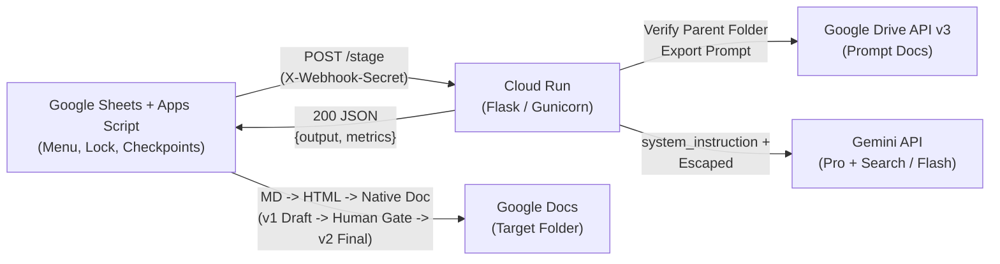

# Human-in-the-Loop (HITL) B2B Content Publishing Engine

> **A serverless, security-hardened publishing pipeline bridging Google Sheets, Google Docs, Cloud Run, and Gemini—turning raw topic briefs into practitioner-grade, SEO/GEO-optimized B2B articles without bypassing human editorial judgment.**

Built for B2B content teams, product marketers, and engineering leaders who want AI research and drafting velocity while keeping human experts in complete control of narrative, accuracy, and brand voice.

---

## Table of Contents

- [Documentation Map](#documentation-map)
- [Key Capabilities](#key-capabilities)
- [High-Level Architecture](#high-level-architecture)
- [Tech Stack](#tech-stack)
- [Quick Start](#quick-start)
- [Repository Structure](#repository-structure)
- [Security & License](#security--license)

---

## Documentation Map

| Document | Audience | What It Covers |
| :--- | :--- | :--- |
| [README.md](./README.md) | All Readers | Executive overview, architecture snapshot, tech stack, and navigation hub. |
| [USER_GUIDE.md](./USER_GUIDE.md) | Content Editors & Editorial Leads | Daily click-by-click Google Sheets/Docs workflow, menu walkthrough, `Experiment_Config` usage, and troubleshooting. |
| [DEVELOPERS.md](./DEVELOPERS.md) | Engineers & Operators | Full GCP/IAM/Secret Manager setup, local dev, `pytest` suite, HTTP API contract, `Code.gs` internals, and CI/CD. |
| [CASE_STUDY.md](./CASE_STUDY.md) | Decision-Makers & Leaders | PSR + 5 Whys + StoryBrand case study detailing the v1->v2 transformation, trade-offs, and results. |
| [prompts/agent_a_researcher.md](./prompts/agent_a_researcher.md) | Prompt & Editorial Leads | Agent A (Research Analyst) system prompt template with `<inputs>` XML contract and epistemic labeling. |
| [prompts/agent_b_planner.md](./prompts/agent_b_planner.md) | Prompt & Editorial Leads | Agent B (Editorial Architect) system prompt template for inverted-pyramid blueprints. |
| [prompts/agent_c_writer.md](./prompts/agent_c_writer.md) | Prompt & Editorial Leads | Agent C (B2B SaaS Writer) system prompt template with ESL readability and HITL editor-note rules. |
| [prompts/agent_d_optimizer.md](./prompts/agent_d_optimizer.md) | Prompt & Editorial Leads | Agent D (SEO/GEO Optimizer) system prompt template with `<draft_text>` contract and metadata appendix. |

---

## Key Capabilities

* **Two-Phase HITL Editorial Gate:** Phase 1 drafts a cited `v1` Google Doc; Phase 2 (`SEO/GEO Optimize`) is strictly blocked until an editor marks the row `Approved` and resolves **all** Google Docs margin comments (`Drive.Comments.list`).
* **Split-Stage Phase 1 with Checkpointing:** Phase 1 runs as three bounded stage calls (`research` -> `plan` -> `write`) with Drive-backed checkpoints—eliminating single-request timeouts and letting editors resume failed runs without re-paying earlier stages.
* **Non-Destructive Sheets Telemetry:** Active tab guards, `LockService.getDocumentLock()`, case-insensitive header mapping, dedicated status/metrics columns (Cols H–L), and automatic archiving of prior Doc URLs in cell Notes.
* **Code-Free Prompt Versioning (`Experiment_Config`):** Switch Agent A–D prompt Docs or target Drive folders from a protected Google Sheets tab without touching code.
* **Defense-in-Depth Cloud Security:** Constant-time `X-Webhook-Secret` authentication, server-side Drive prompt folder verification (`ALLOWED_PROMPT_FOLDER_ID`), GCP Secret Manager mounts, least-privilege runtime IAM, and a `pytest` CI gate before every deploy.

---

## High-Level Architecture



For the full sequence diagram, HTTP API schemas, and stage-by-stage backend internals, see [DEVELOPERS.md](./DEVELOPERS.md).

---

## Tech Stack

| Layer | Technology | Role |
| :--- | :--- | :--- |
| **Frontend & Orchestration** | Google Sheets + Apps Script (V8, Drive v3) | Editorial UI, concurrency locking, stage checkpointing, comment gating, and Markdown-to-Docs import. |
| **Backend Runtime** | Python 3.11 + Flask + Gunicorn | Authenticated HTTP webhook (`/health`, `/stage`), Drive prompt verification, XML escaping, and retries. |
| **AI Engine** | Google Gemini (`google-genai` SDK) | `gemini-3.1-pro-preview` (Research + Search, Writing) and `gemini-3.8-flash` (Planning, SEO/GEO). |
| **Cloud Compute & Secrets** | Google Cloud Run + Secret Manager | Serverless container hosting under a least-privilege runtime SA with mounted secrets. |
| **CI/CD** | Google Cloud Build (`cloudbuild.yaml`) | Automated `pytest` gate -> Docker build -> Artifact Registry push -> Cloud Run update. |

---

## Quick Start

### For Engineers (Self-Hosting & Setup)
1. **Fork & Clone:** Clone the repo and configure branch protection on `main`.
2. **Provision GCP:** Enable required APIs, create the `content-engine-runtime` Service Account, store `GOOGLE_API_KEY_ARTICLE` and `WEBHOOK_SHARED_SECRET` in Secret Manager, and share your Drive prompt folder with the runtime SA as **Viewer**.
3. **Test & Deploy:** Run `pytest` locally and connect your repo to Cloud Build (`cloudbuild.yaml`).
4. **Connect Sheets:** Paste `apps_script/appsscript.json` and `apps_script/Code.gs`, then run **⚙️ Configure Settings** and **🧪 Initialize Experiment_Config Tab**.

-> Full commands and local setup: **[DEVELOPERS.md](./DEVELOPERS.md)**

### For Content Editors (Daily Operations)
1. **Add Brief:** Fill in `Topic`, `Core Focus`, and `Description` on your Article Backlog tab.
2. **Draft (`v1`):** Click **🚀 AI Content Engine -> Phase 1: Generate Draft (v1)**.
3. **Review & Approve:** Edit the `v1` Google Doc, **resolve all margin comments**, and set Column E to `Approved`.
4. **Optimize (`v2`):** Click **🚀 AI Content Engine -> Phase 2: SEO/GEO Optimize (v2)** to generate your CMS-ready Doc.

-> Step-by-step screenshots-in-words and troubleshooting: **[USER_GUIDE.md](./USER_GUIDE.md)**

---

## Repository Structure

```text
.
├── README.md                    # Executive overview and documentation hub
├── DEVELOPERS.md                # Architecture, GCP setup, API contracts, testing, and CI/CD
├── USER_GUIDE.md                # Non-technical editor & editorial lead operating manual
├── CASE_STUDY.md                # PSR + 5 Whys + StoryBrand project case study
├── .env.example                 # Local backend environment variable template
├── cloudbuild.yaml              # Cloud Build CI/CD pipeline (pytest gate -> Docker -> Cloud Run)
├── apps_script/
│   ├── Code.gs                  # Sheets menu, split-stage orchestrator, checkpointing, MD->HTML import
│   └── appsscript.json          # Apps Script manifest enabling Drive v3 Advanced Service
├── backend/
│   ├── Dockerfile               # Hardened python:3.11.11-slim-bookworm non-root Gunicorn image
│   ├── .dockerignore            # Excludes tests, local envs, and caches from container builds
│   ├── main.py                  # Authenticated stage webhook + Drive allowlist fetcher + Gemini client
│   ├── requirements.txt         # Pinned Python runtime and test dependencies
│   └── tests/test_main.py       # 30-case pytest suite (auth, Drive boundary, XML, retries, stages)
└── prompts/                     # Sanitized Markdown templates for Agents A, B, C, and D
```

---

## Security & License

`hitl-content-engine` keeps zero secrets in source control: Cloud Run authenticates callers via `X-Webhook-Secret` (`hmac.compare_digest`), fetches prompts server-side only from `ALLOWED_PROMPT_FOLDER_ID` under a least-privilege Service Account, and mounts API keys exclusively from GCP Secret Manager. See the [Security Model section in DEVELOPERS.md](./DEVELOPERS.md#9-security-model--extending-the-engine) for the full control matrix and zero-downtime key rotation steps.

**License:** No `LICENSE` file is currently included in this repository (all rights reserved by the repository owner unless a license is added).
