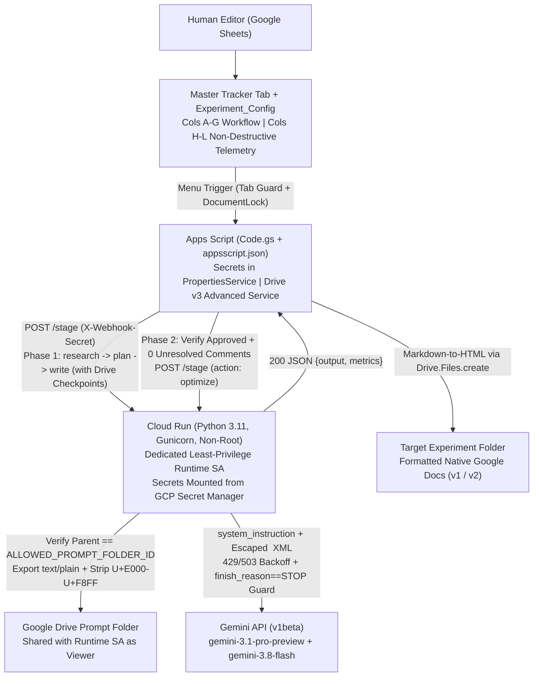

# Human-in-the-Loop (HITL) B2B Content Publishing Engine

An automated, serverless B2B content generation and publishing pipeline bridging **Google Sheets**, **Google Docs**, and **Google Cloud Run**. The engine uses multi-stage Gemini reasoning (`google-genai`) to research, architect, draft, and optimize technical long-form articles while enforcing a strict **Human-in-the-Loop (HITL)** editorial gate between drafting and final SEO/GEO optimization.

> **Personal Note:** I originally built this engine to support my own blog and scale technical Product Management writing without turning my content workflow into an unverified AI "feature factory."

---

## 1. Why This Architecture Exists

Scaling technical B2B content typically forces an undesirable trade-off:
* **The Velocity Trap:** Autonomous AI pipelines publish unverified prose filled with clichés and hallucinated claims.
* **The Editorial Bottleneck:** Senior PMs and subject-matter experts spend days researching, outlining, and formatting every piece from scratch.

**The Solution:** Separate content production into two gated phases:
1. **Phase 1 (Automated Drafting — `v1`):** Three specialized AI stages (`research` -> `plan` -> `write`) execute sequentially with intermediate Drive checkpointing to produce a cited, blueprint-driven `v1` Google Doc.
2. **Mandatory Human Gate:** A human editor refines the narrative, injects proprietary examples, resolves all Google Docs margin comments, and marks the row `Approved`.
3. **Phase 2 (SEO/GEO Optimization — `v2`):** Only after verifying `Approved` status **and** `0` unresolved Google Docs comments does Agent D optimize structure for search/answer engines, append a separated `## SEO & GEO Metadata` package, and mark the row `Ready for CMS`.

---

## 2. Architecture & Security Model



### Key Security & Reliability Controls
* **Authenticated Webhook (`X-Webhook-Secret`):** Cloud Run validates `X-Webhook-Secret` in constant time via `hmac.compare_digest` (`401` on mismatch), exposes `GET /health` (`200`), rejects all other non-`POST` methods (`405`), and omits wildcard CORS headers.
* **Server-Side Prompt Trust Boundary:** Callers never send raw system prompts. Apps Script sends a `prompt_doc_id` from `Experiment_Config`; Cloud Run verifies via Drive API v3 that the file resides inside `ALLOWED_PROMPT_FOLDER_ID`, exports `text/plain`, and strips Google Docs private-use control characters (`U+E000–U+F8FF`).
* **Prompt-Injection & Output Hardening:** System prompts are isolated in `GenerateContentConfig(system_instruction=...)`, untrusted inputs are XML-escaped inside `<inputs>...</inputs>`, `finish_reason == STOP` and non-empty output are enforced on every stage, and `strip_scratchpad()` uses an anchored regex that rejects unclosed `<scratchpad>` tags.
* **Split-Stage Execution & Checkpointing:** Phase 1 runs as three bounded HTTP requests (`research`, `plan`, `write`) with exponential backoff on transient `429`/`503` errors and per-stage JSON checkpoints in Drive—allowing Stage 3 retries without re-paying for Stages 1–2.
* **Non-Destructive Sheet Telemetry & Formatting:** Transient progress, experiment IDs, checkpoints, token/latency metrics, and errors are logged in Columns H–L (archiving replaced URLs in cell Notes), and Markdown is converted to HTML and imported via `Drive.Files.create` directly into the target folder.

---

## 3. Repository Structure

```text
.
├── .env.example                 # Local environment variable template (no real secrets)
├── cloudbuild.yaml              # CI/CD pipeline: runs pytest gate before Docker build & Cloud Run deploy
├── apps_script/
│   ├── Code.gs                  # Sheet menu, split-stage orchestrator, checkpointing, MD->HTML Drive importer
│   └── appsscript.json          # Apps Script manifest enabling Drive v3 Advanced Service & OAuth scopes
├── backend/
│   ├── .dockerignore            # Excludes tests, caches, and local env files from container image
│   ├── Dockerfile               # Hardened python:3.11.11-slim-bookworm, non-root appuser, Gunicorn entrypoint
│   ├── main.py                  # Authenticated stage webhook (research, plan, write, optimize) + Drive fetcher
│   ├── requirements.txt         # Pinned runtime and test dependencies
│   └── tests/
│       └── test_main.py         # Unit test suite covering auth, Drive allowlist, XML/scratchpad, and stages
└── prompts/
    ├── agent_a_researcher.md    # Sanitized Agent A (Research Analyst) prompt template
    ├── agent_b_planner.md       # Sanitized Agent B (Editorial Architect) prompt template
    ├── agent_c_writer.md        # Sanitized Agent C (B2B SaaS Writer) prompt template
    └── agent_d_optimizer.md     # Sanitized Agent D (SEO/GEO Optimizer) prompt template
```

---

## 4. Google Sheets Schema

### A. Content Tracker Tab (`Article Backlog` / `Arical backlog`)

| Column | Header | Purpose |
| :--- | :--- | :--- |
| **A** | `Topic` | Primary subject of the article (required). |
| **B** | `Core Focus` | Specific thesis, angle, or case study focus. |
| **C** | `Description` | Audience, series context, and editorial notes. |
| **D** | `Output Doc Link` | Generated `v1 (Draft)` Google Doc URL (prior URLs archived in cell Note). |
| **E** | `Human Edits` | Editorial gate dropdown: `Pending Review`, `In Revision`, `Approved`. |
| **F** | `Reviewed Doc Link` | Generated `v2 (Final)` Google Doc URL (prior URLs archived in cell Note). |
| **G** | `Human Review` | Set automatically to `Ready for CMS` after Phase 2 completes. |
| **H** | `Pipeline Status` | Non-destructive live stage progress (`⏳`, `✅`, `⏸️`, `❌`). |
| **I** | `Experiment ID` | Optional per-row `Experiment_ID` override; otherwise records the active config used. |
| **J** | `Checkpoint State` | Tracks Stage 1/2 checkpoint persistence and cleanup. |
| **K** | `Last Run Metrics` | Timestamp, per-stage duration, and Gemini token counts. |
| **L** | `Last Error` | Timestamped error details if a stage fails (never overwrites Doc links). |

### B. `Experiment_Config` Tab (Protected)
Use **🚀 AI Content Engine -> 🧪 Initialize Experiment_Config Tab** to generate this sheet automatically:

| Column | Header | Description |
| :--- | :--- | :--- |
| **A** | `Experiment_ID` | Unique identifier (e.g., `exp_v2_default`). |
| **B** | `Active` | Set `TRUE` on the default configuration row. |
| **C** | `Researcher_Doc_ID` | Google Doc ID for Agent A inside `ALLOWED_PROMPT_FOLDER_ID`. |
| **D** | `Planner_Doc_ID` | Google Doc ID for Agent B inside `ALLOWED_PROMPT_FOLDER_ID`. |
| **E** | `Writer_Doc_ID` | Google Doc ID for Agent C inside `ALLOWED_PROMPT_FOLDER_ID`. |
| **F** | `Optimizer_Doc_ID` | Google Doc ID for Agent D inside `ALLOWED_PROMPT_FOLDER_ID`. |
| **G** | `Draft_Folder_ID` | Target Google Drive folder ID for `v1` drafts and temporary stage checkpoints. |
| **H** | `Final_Folder_ID` | Target Google Drive folder ID for `v2` final articles (defaults to `Draft_Folder_ID` if blank). |
| **I** | `Notes` | Optional notes describing prompt versions or experiments. |

---

## 5. Step-by-Step Setup & Replication Guide

### Step 1: Prepare Google Drive Folders & Prompt Docs
1. Create two folders in Google Drive:
   * **Prompt Folder:** Copy its folder ID from the URL — this will be your `ALLOWED_PROMPT_FOLDER_ID`.
   * **Output Folder:** Copy its folder ID for `Draft_Folder_ID` / `Final_Folder_ID`.
2. Upload the four Markdown templates in [`prompts/`](./prompts) (`agent_a_researcher.md` through `agent_d_optimizer.md`) into your **Prompt Folder** as native **Google Docs** (*File -> Save as Google Docs* if uploaded as Markdown/text) and note each Doc ID.

### Step 2: Provision GCP APIs, Runtime Service Account & Secret Manager
1. Enable the required Google Cloud APIs in your GCP project:
   ```bash
   gcloud services enable \
     run.googleapis.com \
     cloudbuild.googleapis.com \
     artifactregistry.googleapis.com \
     secretmanager.googleapis.com \
     drive.googleapis.com \
     --project="YOUR_GCP_PROJECT_ID"
   ```
2. Create a dedicated least-privilege runtime Service Account for Cloud Run:
   ```bash
   gcloud iam service-accounts create content-engine-runtime \
     --display-name="HITL Content Engine Cloud Run Runtime" \
     --project="YOUR_GCP_PROJECT_ID"

   gcloud projects add-iam-policy-binding "YOUR_GCP_PROJECT_ID" \
     --member="serviceAccount:content-engine-runtime@YOUR_GCP_PROJECT_ID.iam.gserviceaccount.com" \
     --role="roles/logging.logWriter"
   ```
3. Generate a 32-byte webhook secret (`openssl rand -hex 32`) and store both `GOOGLE_API_KEY_ARTICLE` (from Google AI Studio) and `WEBHOOK_SHARED_SECRET` in **Secret Manager**, granting `roles/secretmanager.secretAccessor` **only** on those two secrets to `content-engine-runtime@YOUR_GCP_PROJECT_ID.iam.gserviceaccount.com`.

### Step 3: Share the Drive Prompt Folder with the Runtime Service Account (Mandatory)
> **CRITICAL REPLICATION STEP — Drive Service Account Sharing:**
> Because Cloud Run fetches and verifies Agent A–D prompt Docs server-side using the Google Drive API (`drive.googleapis.com`), you **must**:
> 1. Confirm `drive.googleapis.com` is enabled in your GCP project (Step 2.1 above).
> 2. In Google Drive, right-click your **Prompt Folder** (`ALLOWED_PROMPT_FOLDER_ID`) -> **Share**, and add your Cloud Run runtime Service Account email (`content-engine-runtime@YOUR_GCP_PROJECT_ID.iam.gserviceaccount.com`) with **Viewer** permission.
>
> *(Cloud Run only needs **Viewer** access to the Prompt Folder; Google Docs creation in the Output Folder is executed by Apps Script under the human editor's Drive permissions.)*

### Step 4: Run Tests & Deploy Cloud Run
1. Run the local unit test suite before deploying:
   ```bash
   python3 -m venv .venv
   .venv/bin/pip install -r backend/requirements.txt
   .venv/bin/pytest -v backend/tests/test_main.py
   ```
2. Deploy to Cloud Run using the hardened [`backend/Dockerfile`](./backend/Dockerfile) (or [`cloudbuild.yaml`](./cloudbuild.yaml), which enforces `pytest` before building the image):
   ```bash
   gcloud run deploy hitl-content-webhook \
     --source=backend \
     --region="europe-west1" \
     --service-account="content-engine-runtime@YOUR_GCP_PROJECT_ID.iam.gserviceaccount.com" \
     --set-env-vars="ALLOWED_PROMPT_FOLDER_ID=YOUR_PROMPT_FOLDER_ID" \
     --set-secrets="GOOGLE_API_KEY_ARTICLE=gemini-api-key:latest,WEBHOOK_SHARED_SECRET=webhook-shared-secret:latest" \
     --concurrency=4 \
     --max-instances=3 \
     --memory=2Gi \
     --cpu=1 \
     --timeout=300 \
     --allow-unauthenticated
   ```
   *(Note: If deploying via Cloud Run Buildpacks instead of `backend/Dockerfile`, also set `GOOGLE_FUNCTION_TARGET=generate_blog_post`.)*

### Step 5: Configure Google Sheets & Bound Apps Script
1. Create your Master Content Tracker Google Sheet with Columns A–G (add a Data Validation dropdown on Column E with `Pending Review`, `In Revision`, `Approved`).
2. Open **Extensions -> Apps Script**:
   * In **Project Settings**, check **Show "appsscript.json" manifest file in editor**.
   * Paste [`apps_script/appsscript.json`](./apps_script/appsscript.json) (which enables the **Drive API v3** Advanced Service) and [`apps_script/Code.gs`](./apps_script/Code.gs), then save.
3. Reload the Google Sheet and use the **🚀 AI Content Engine** menu:
   * Click **🧪 Initialize Experiment_Config Tab** and paste your Agent A–D Google Doc IDs and target Drive Folder IDs.
   * Click **⚙️ Configure Settings** to store your `CLOUD_RUN_URL` and `WEBHOOK_SHARED_SECRET` in `PropertiesService`.
