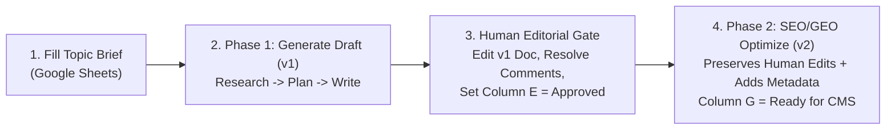

# Editor & Operations User Guide

Welcome to the **Human-in-the-Loop (HITL) B2B Content Publishing Engine**. This guide walks content editors, product marketers, and editorial leads through turning a topic brief in Google Sheets into a polished, SEO/GEO-optimized Google Doc ready for your CMS.

*(Looking for technical setup, cloud deployment, or code internals? See [DEVELOPERS.md](./DEVELOPERS.md).)*

---

## 1. Welcome & How the Workflow Works

This publishing engine pairs AI research and drafting speed with mandatory human editorial judgment. In **Phase 1**, the engine automatically researches, outlines, and writes a structured `v1` draft in Google Docs. A **human editor** then reviews the draft, adds proprietary insights, resolves all comments, and marks the row `Approved` before **Phase 2** polishes the piece for search and AI answer engines (`v2`).

---

## 2. Understanding Your Google Sheet

Your Master Content Tracker workbook (`your-master-tracker-sheet`) contains three tabs.

### Tabs Overview

* **Article Backlog (`Arical backlog` or `Article Backlog`):** Your daily workspace where articles are queued, drafted, reviewed, and linked. *(Note: Depending on your workbook version, this tab may be named `Arical backlog` or `Article Backlog`—both work identically.)*
* **`Topic Backlog`:** An idea parking lot for rough brainstorms.
  > **Important:** Never run any **🚀 AI Content Engine** menu commands while on `Topic Backlog`—the engine will block execution to protect your ideas from being overwritten.
* **`Experiment_Config`:** A protected control tab used by editorial leads to manage prompt document versions and output folders.

### Column-by-Column Reference (`Article Backlog`)

Depending on your sheet's setup, Columns E and G may appear as **`Human Edits`** / **`Humen Edites`** and **`Human Review`** / **`Himen Review`**. The engine recognizes both automatically.

#### Columns You Fill In

| Col | Header | What to Enter |
| :--- | :--- | :--- |
| **A** | `Topic` | **(Required)** The clear working subject of the article. |
| **B** | `Core Focus` | The central thesis, angle, or case study focus for the article. |
| **C** | `Description` | Audience context, series notes, or specific points to cover. |
| **E** | `Human Edits` *(or `Humen Edites`)* | Editorial gate status: starts as `Pending Review` after Phase 1. Change to **`Approved`** once your review is complete. |

#### Columns Updated Automatically by the Engine

| Col | Header | What the Engine Writes |
| :--- | :--- | :--- |
| **D** | `Output Doc Link` | Link to the generated **`[Topic] - v1 (Draft)`** Google Doc. |
| **F** | `Reviewed Doc Link` | Link to the final **`[Topic] - v2 (Final)`** Google Doc. |
| **G** | `Human Review` *(or `Himen Review`)* | Automatically set to **`Ready for CMS`** when Phase 2 finishes. |
| **H** | `Pipeline Status` | Live progress badge (`⏳ Stage 1/3...`, `✅ Phase 1 Complete`, `⏸️ Blocked: ...`, `❌ Failed...`). |
| **I** | `Experiment ID` | Records which `Experiment_Config` row was used (or lets leads specify a per-row override). |
| **J** | `Checkpoint State` | Tracks automatic progress saving during Phase 1 (`Stage 1/3 Saved`, `Stages 1-2 Saved`, `Cleared (Completed)`). |
| **K** | `Last Run Metrics` | Timestamp, stage durations, and token usage from the last completed run. |
| **L** | `Last Error` | Timestamped error details if a run fails—your Doc links in Columns D and F are never overwritten by errors. |

---

## 3. Menu Walkthrough (`🚀 AI Content Engine`)

Once your workbook opens, the **🚀 AI Content Engine** menu appears in the top toolbar next to *Help*.

| Menu Item | Who Should Click It | When to Use |
| :--- | :--- | :--- |
| **Phase 1: Generate Draft (v1)** | Editors | When a row has a filled `Topic` and needs a `v1` draft (or to resume an interrupted Phase 1 run). |
| **Phase 2: SEO/GEO Optimize (v2)** | Editors | Only **after** the `v1` Doc is edited, all comments are resolved, and Column E is set to `Approved`. |
| **🗑️ Clear Selected Row Checkpoint** | Editors / Leads | If you want to discard saved Phase 1 progress on the selected row and force a clean restart from Stage 1. |
| **🧪 Initialize Experiment_Config Tab** | Editorial Leads / Admins | One-time setup to create the `Experiment_Config` tab if it does not exist yet. |
| **⚙️ Configure Settings** | Admins Only | One-time setup (or secret rotation) to connect the sheet to your organization's AI service. |

> **First-Time Authorization:** The very first time you click any menu item, Google will display an **"Authorization Required"** prompt asking for permission to read/write your Google Sheets and Google Docs. Click **Continue**, choose your Google account, and click **Allow**, then click the menu item once more to run it.

---

## 4. Step-by-Step Daily Workflow

### Step 1: Add a New Topic Row

1. Open your **Article Backlog** tab (`Arical backlog` / `Article Backlog`) and scroll to the next empty row (Row 2 or below).
2. Fill in Columns A–C clearly—specific briefs produce significantly sharper `v1` drafts:

| Column A (`Topic`) | Column B (`Core Focus`) | Column C (`Description`) |
| :--- | :--- | :--- |
| `Usage-Based Pricing in B2B SaaS` | `Why hybrid seat + usage models outperform pure metering` | `Written for VP Product and Finance leaders. Cover billing predictability, customer churn risks, and include a decision checklist.` |

> **Tip:** Leave Columns D–L blank for a brand-new article. The engine fills them in automatically.

---

### Step 2: Run Phase 1 — Generate Draft (v1)

1. Click any cell in your target article's row (Row 2 or below) on the **Article Backlog** tab.
2. In the top toolbar, click **🚀 AI Content Engine -> Phase 1: Generate Draft (v1)**.
3. Wait **~2–3 minutes** while the engine runs three automatic stages in sequence:
   * `⏳ Stage 1/3: Researching...` *(gathers facts, frameworks, and verified sources)*
   * `⏳ Stage 2/3: Planning Blueprint...` *(builds the article outline and structure)*
   * `⏳ Stage 3/3: Writing v1 Draft...` *(writes the full formatted draft)*
4. After Stages 1 and 2 finish, the engine automatically saves your progress in **Checkpoint State** (Column J). If a network hiccup interrupts Stage 3, you can re-run Phase 1 and choose **YES** to resume without repeating earlier stages.
5. **What success looks like:**
   * A popup appears: **`Phase 1 Complete!`** with the link to your new **`[Topic] - v1 (Draft)`** Google Doc.
   * **Column D** (`Output Doc Link`) contains the clickable Google Doc URL.
   * **Column E** (`Human Edits`) is set to **`Pending Review`**.
   * **Column H** (`Pipeline Status`) shows **`✅ Phase 1 Complete`**.

---

### Step 3: Human Editorial Review (The Mandatory Quality Gate)

This step ensures every published piece reflects genuine human expertise and verified facts.

1. Open the **`[Topic] - v1 (Draft)`** Google Doc from **Column D**.
2. Edit the document directly in Google Docs:
   * Refine the narrative voice, tighten transitions, and verify technical claims.
   * Address any `> ⚠️ EDITOR NOTE:` callouts where the AI requested proprietary company examples, internal metrics, or SME quotes.
   * Delete any leftover editor notes you chose not to answer.
3. > **Important — Resolve All Google Docs Comments:**
   > Before running Phase 2, you **must** incorporate and click **Resolve** on every margin comment in the `v1` Google Doc. If any comment remains unresolved, Phase 2 will intentionally pause with **`⏸️ Blocked: N Unresolved Comment(s)`** so reviewer feedback is never silently ignored.
4. Return to your Google Sheet and change **Column E** (`Human Edits`) from `Pending Review` to **`Approved`**.

---

### Step 4: Run Phase 2 — SEO/GEO Optimize (v2)

1. Click any cell in your **`Approved`** row on the **Article Backlog** tab.
2. Click **🚀 AI Content Engine -> Phase 2: SEO/GEO Optimize (v2)**.
3. Wait **~30–60 seconds** while Column H displays `⏳ Phase 2: Optimizing SEO/GEO...`.
4. During Phase 2, the engine:
   * Preserves all of your human edits, stories, and verified citations.
   * Sharpens headings and direct-answer clarity for search engines and AI answer engines (GEO).
   * Appends a separated **`## SEO & GEO Metadata`** section (SEO Title, Meta Description, URL Slug, keywords, and visual/alt-text ideas) at the bottom of the Doc.
   * Saves a brand-new formatted **`[Topic] - v2 (Final)`** Google Doc.
5. **What success looks like:**
   * A popup appears: **`Phase 2 Complete!`** with the new `v2` Doc URL.
   * **Column F** (`Reviewed Doc Link`) contains the clickable `v2 (Final)` Google Doc link.
   * **Column G** (`Human Review`) is set to **`Ready for CMS`**.
   * **Column H** (`Pipeline Status`) shows **`✅ Phase 2 Complete`**.

---

## 5. Working with Experiments & Re-Running Articles (For Editorial Leads)

### Switching Prompt Versions or Output Folders (`Experiment_Config`)

Editorial leads can test updated AI prompt templates or route drafts to a new Google Drive folder without touching any code:

1. Open the **`Experiment_Config`** tab.
2. Add a new row with a unique `Experiment_ID` (for example, `exp_v2_prod`), your four prompt Google Doc IDs (`Researcher_Doc_ID`, `Planner_Doc_ID`, `Writer_Doc_ID`, `Optimizer_Doc_ID`), and your target `Draft_Folder_ID` / `Final_Folder_ID`.
3. > **Important:** To make a configuration the default for all new runs, set **`Active`** (Column B) to **`TRUE`** on **exactly one row** and set older rows to `FALSE`.
   * *Tip for testing:* To test a new experiment on just one article without changing the team default, leave `Active` as `FALSE` and type that row's `Experiment_ID` directly into **Column I** (`Experiment ID`) on your backlog row.

### Re-Running a Draft or Optimization

If you run Phase 1 on a row that already has a link in Column D (or Phase 2 on a row that already has a link in Column F), the engine asks for confirmation first:
* **`Existing v1 Draft Detected`** / **`Existing v2 Final Doc Detected`** -> Click **Yes** to generate a fresh Doc, or **No** to cancel.
* **Your previous link is never lost:** Before writing the new Doc URL into Column D or Column F, the engine automatically archives the old URL inside that cell's **Note** (hover over the cell to view prior URLs and timestamps).

---

## 6. Troubleshooting Common Messages & Errors

| Symptom / Alert Message | Why It Happened | How to Fix It |
| :--- | :--- | :--- |
| **`Wrong Sheet Tab!`** | You clicked Phase 1 or Phase 2 while viewing `Topic Backlog` or `Experiment_Config`. | Switch back to your **Article Backlog** tab (`Arical backlog` / `Article Backlog`), select your row, and try again. |
| **`Approval Gate Blocked!`** | Column E (`Human Edits`) is still `Pending Review`, `In Revision`, or blank. | Finish reviewing the `v1` Doc, type **`Approved`** in Column E, and re-run Phase 2. |
| **`Unresolved Comments Gate Blocked!`** *(Col H: `⏸️ Blocked: ...`)* | One or more margin comments in the `v1` Google Doc are still open. | Open the `v1` Doc, address the feedback in the text, click **Resolve** on every comment, and re-run Phase 2. |
| **`Concurrency Lock Active`** | Another editor—or a double-click—is currently running Phase 1 or Phase 2 on this sheet. | Wait 1–2 minutes for the active run to finish, then try again. |
| **`No active row (Active = TRUE) found in "Experiment_Config"`** | All rows in `Experiment_Config` are set to `FALSE`, or the active row was deleted. | Open `Experiment_Config` and set `Active` to `TRUE` on your active configuration row. *(Ensure only one row is `TRUE`.)* |
| **`Selected row (X) has no Topic`** | Column A is empty on the row you clicked. | Click a row that has a `Topic` in Column A (Row 2 or below). |
| **`The approved v1 Google Doc is empty`** | The `v1` Doc linked in Column D has no text. | Open the Doc in Column D to verify its contents, or re-run Phase 1 to regenerate it. |
| **`INPUT ERROR: ...`** | An AI agent rejected the inputs because the `Topic` or brief was missing/unusable. | Expand your `Topic`, `Core Focus`, and `Description` in Columns A–C and re-run. |
| **`Saved Checkpoint Found (Row X)`** | A previous Phase 1 run stopped after Stage 1 or Stage 2 and saved your progress. | Click **Yes** to resume from the saved stage, **No** to restart from Stage 1, or **Cancel** to abort. |
| **`Missing ScriptProperties configuration` / `Unauthorized`** | The sheet's backend connection URL or shared secret is missing or out of date. | Contact your editorial admin or developer to re-run **⚙️ Configure Settings** (see [DEVELOPERS.md](./DEVELOPERS.md)). |

---

## 7. Frequently Asked Questions (FAQ)

**How long does Phase 1 vs. Phase 2 take?**
Phase 1 typically takes **2–3 minutes** because it runs three sequential AI stages (Research, Plan, and Write). Phase 2 runs a single optimization pass and usually finishes in **30–60 seconds**.

**Can I run two rows at the same time?**
No. The sheet uses a document-level lock (`Concurrency Lock Active`) so two runs cannot collide or overwrite each other's status. Wait for the current row to finish before starting the next row.

**Will Phase 2 erase the stories or data I added during my review?**
No. Agent D is instructed to preserve all human-added anecdotes, proprietary metrics, and verified citations from your `v1` Doc. It only improves search/GEO structure and appends the SEO metadata block at the end.

**What happens to my old Google Doc if I re-run Phase 1?**
The old Google Doc stays untouched in Google Drive, and its URL is automatically saved inside the **cell Note** on Column D (hover over the cell to see it).

**Where are my generated Google Docs saved in Google Drive?**
Phase 1 (`v1`) Docs are saved in the **`Draft_Folder_ID`** configured on your active row in `Experiment_Config`. Phase 2 (`v2`) Docs are saved in **`Final_Folder_ID`** (or `Draft_Folder_ID` if `Final_Folder_ID` is blank).

**Does capitalization matter when typing "Approved" in Column E?**
No—`Approved`, `approved`, and `APPROVED` are all accepted, and extra leading/trailing spaces are ignored automatically.

**Who should I contact if the menu doesn't appear or a connection error persists?**
First, wait 5–10 seconds after opening the sheet and refresh the browser tab once if **🚀 AI Content Engine** hasn't loaded yet. If the menu still does not appear or you see `Unauthorized` / `Missing ScriptProperties configuration` errors, contact your team's technical administrator (who can follow the troubleshooting steps in [DEVELOPERS.md](./DEVELOPERS.md)).
